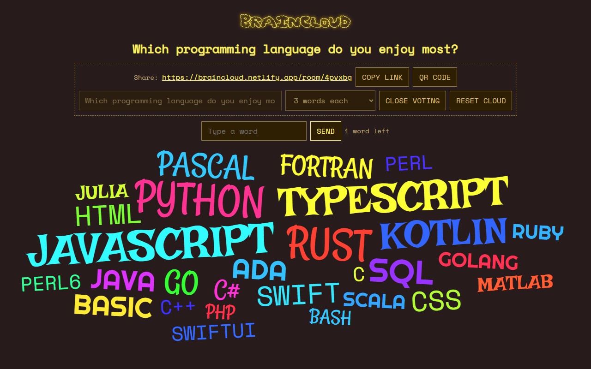
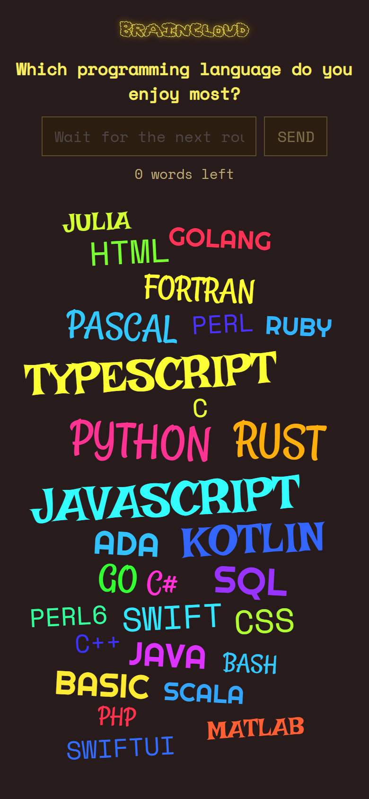
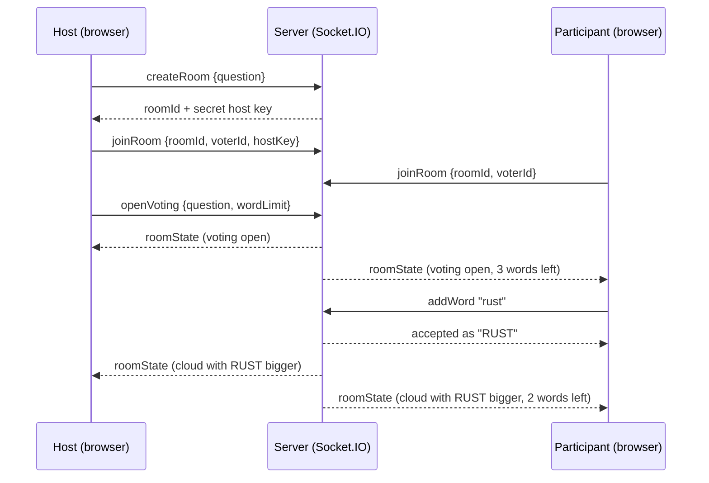

# Braincloud

**Ask a question, share a link, and watch everyone's answers grow into a live word cloud.**

Create a room, share the link or QR code, and open voting. Everyone sends their words from their phone or laptop, and the cloud grows in real time on every screen: the more people send a word, the bigger it gets. No sign-up, nothing stored.

**Live demo:** https://braincloud.netlify.app/ (press "Try a demo" for a room that already has words in it)

<p align="center">
  
  
</p>

## How a session works

1. **Create a room.** Type a question (optional) and press "Create room". You're the host, and you get a share link such as `braincloud.netlify.app/room/4pvxbg`.
2. **Invite people.** Send the link, or show its QR code on a screen.
3. **Open voting.** Pick how many words each person gets this round: 1, 3, 5 or unlimited.
4. **Watch it grow.** Each word sent makes that word bigger for everyone. The word you just sent flashes yellow, so you can see your vote land.
5. **Run more rounds.** Close voting, change the question or the word limit, and open it again. Everyone gets their full allowance back, and the cloud is kept unless you reset it.

The room stays open if the host refreshes or loses connection; the host gets their controls back on return. A room closes 10 minutes after everyone has left.

## Features

- **Rooms with a host.** Only the host can open or close voting, change the question, set the word limit and reset the cloud.
- **No accounts.** The host is recognised by a secret key saved in their browser; participants by an anonymous ID, so their word allowance can be counted without asking for a name.
- **Fair voting.** Words are tidied (trimmed, capitals, 24 characters max), checked against a list of offensive words and counted on the server, so the limits can't be bypassed from the browser.
- **A steady cloud.** Each word always gets the same colour, font and tilt, the layout is repeatable, and words glide to their new places instead of the whole cloud reshuffling on every vote.
- **Works on phones.** The layout adapts, and the QR code makes joining from a phone quick.

## How it works



- **Server:** Node.js and Socket.IO, with rooms kept in memory (no database).
  - `rooms.js` holds the room rules as plain functions (`createRoom`, `openVoting`, `addWord`, `wordsLeftFor`…), with no networking, so they're easy to test.
  - `index.js` receives messages, checks who's asking, and sends each person their own view of the room. Everyone gets the same cloud, but their own number of words left.
- **Client:** React with Vite.
  - [d3-cloud](https://github.com/jasondavies/d3-cloud) works out where each word goes; React draws the result as SVG.
  - Words are measured in their real fonts, and if any word doesn't fit, everything shrinks a little and is laid out again, so no word is ever silently dropped.
  - Word sizes grow with votes on a logarithmic scale, so a popular word can't take over the screen.

### Socket events

| Event | From | Purpose |
| --- | --- | --- |
| `createRoom` | client | Create a room (optionally a demo room); replies with the room ID and host key |
| `joinRoom` | client | Join a room by ID; the host also sends their key |
| `openVoting` | host | Start a round with a question and a word limit |
| `closeVoting` | host | Stop accepting words |
| `resetCloud` | host | Remove every word |
| `addWord` | client | Send a word; replies with the stored word or the reason it wasn't accepted |
| `roomState` | server | The room as this person sees it: question, voting status, words left and the cloud |

## Running locally

Requires Node.js 22 or newer. From the repository root:

```sh
npm run install:all   # first time only
npm run dev           # server on :8000 + client on :5173
```

Open http://localhost:5173. Your browser remembers who you are, so to join your own room as a participant too, use a second browser or a private window.

```sh
npm test              # server tests (node --test)
```

## Project structure

```
braincloud/
├── client/                  React app (Vite)
│   └── src/
│       ├── pages/           HomePage (create or demo), RoomPage
│       ├── components/      HostPanel, WordForm, WordCloud, Title
│       ├── socket.js        the connection to the server
│       ├── browser-storage.js   voter ID and host keys
│       └── word-style.js    each word's colour, font and tilt
├── server/
│   ├── index.js             Socket.IO server
│   ├── rooms.js             room rules (+ rooms.test.js)
│   ├── clean-word.js        tidies and checks words
│   ├── bad-words.js         words that aren't allowed
│   └── demo-words.js        the demo room's starting words
└── docs/screenshots/
```

## Deployment

| Part | Host | Settings |
| --- | --- | --- |
| Client | Netlify | Base directory `client`; build settings in `client/netlify.toml` |
| Server | Koyeb | Work directory `server`, port 8000 |

The client connects to the live server by default. Set `VITE_SERVER_URL` to point it at another server.

## Limits and what's next

- **Rooms live in memory.** A server restart or redeploy closes every open room. Fine for live sessions; saving finished clouds would need storage again.
- **Word allowances are per browser.** A private window counts as a new person. That's enough for a friendly session, but it isn't a secure ballot.
- **Ideas:** let the host choose how strongly sizes differ, show vote counts on the words, and download the cloud as an image.

## Background

I built Braincloud in 2023 as a single shared word cloud with an admin login, time-limited session codes and a MongoDB database, then simplified it into an open demo.

In November 2026 I rebuilt it around rooms, using AI-assisted development for this phase: merging the client and server repositories into this one with their full history, replacing the admin login and database with host-run rooms kept in memory, moving the client to Vite, and adding tests. The idea, the look and the original app date from 2023; the commits from November 2026 onwards are the AI-assisted rebuild.

Built by Fel · [cardini.dev](https://cardini.dev)
